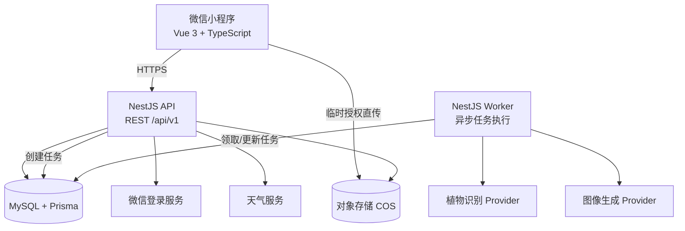
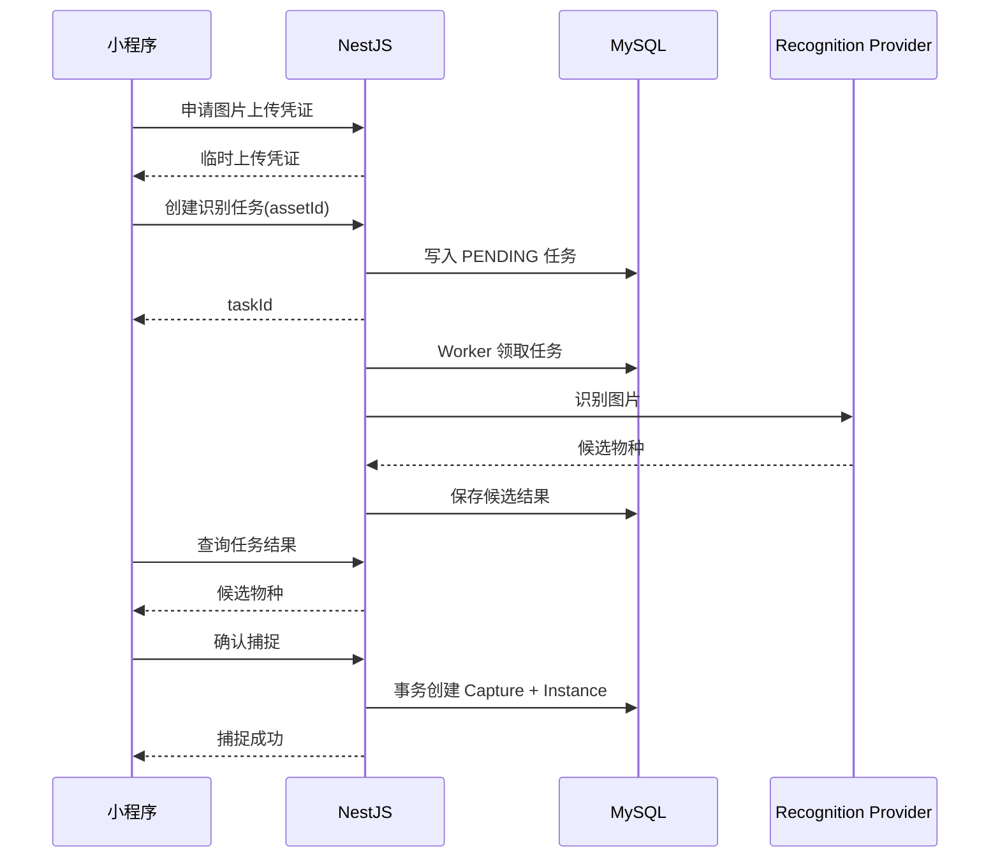

# 01 - FloraVerse 后端总体架构

## 1. 建设目标

FloraVerse 当前已有微信小程序前端初版，包含：

- 营地：用户信息、地理位置、天气、环境属性加成、近期收获。
- 图鉴：物种分类图鉴、用户捕捉个体收藏。
- 排行：物种收录数量排行、植物战力排行。
- 我的：用户详情。

后端 V1 的目标不是一次性实现完整 MMORPG，而是将当前前端 Mock 闭环迁移为可信的在线业务系统，并为 AI 识别、AI 生成、养成、战斗、好友和联机能力预留边界。

## 2. 架构原则

1. **模块化单体优先**：一个 NestJS 代码仓库、一个主要 API 进程；任务 Worker 可作为同仓库的独立进程运行。
2. **服务端权威**：用户身份、捕捉结果、经验、属性、战力和排行榜数据由服务端决定。
3. **AI 可替换**：业务模块只依赖内部 AI 接口，不直接依赖某一家厂商 SDK 的数据结构。
4. **物种与个体分离**：PlantSpecies 描述自然界物种；PlantInstance 描述用户拥有的游戏个体。
5. **异步任务持久化**：AI 调用不占用长连接 HTTP 请求；任务状态必须可恢复、可查询。
6. **低成本演进**：先使用 MySQL 任务表；有明确并发和吞吐需求后再引入 Redis/BullMQ。
7. **隐私最小化**：精确地理位置、原始照片和个人资料按必要性收集、最小权限访问。

## 3. 逻辑架构



## 4. 运行单元

### 4.1 API 进程

职责：
- HTTP 路由、参数校验、认证和授权。
- 调用业务服务。
- 创建持久化任务。
- 返回统一响应。
- 提供 Swagger 文档。

### 4.2 Worker 进程

职责：
- 从 MySQL 任务表领取待处理任务。
- 调用植物识别或图像生成 Provider。
- 更新任务状态、结果和错误信息。
- 处理超时、重试和失败任务。

API 和 Worker 共用一个代码仓库、领域模块和 Prisma Client，但使用不同启动入口或运行命令。

## 5. NestJS 模块边界

| 模块 | 主要职责 |
|---|---|
| AuthModule | 微信登录、Token、会话 |
| UsersModule | 用户资料、用户设置 |
| TaxonomyModule | 科、属、分类树 |
| SpeciesModule | 植物物种主数据 |
| AssetsModule | 上传凭证、资产元数据 |
| RecognitionModule | 植物识别任务与候选结果 |
| CapturesModule | 用户确认捕捉、捕捉记录 |
| CollectionsModule | 图鉴、收录统计 |
| InstancesModule | 用户植物个体、成长和属性 |
| EnvironmentModule | 位置、天气、环境规则 |
| RankingModule | 排行榜 |
| GenerationModule | 图像生成任务和视觉资产 |
| HealthModule | 健康检查 |

模块之间通过服务接口协作，避免互相直接操作其他模块内部实现。初期可以共享 Prisma Client，但业务写入应由所属模块负责。

## 6. 推荐项目目录

```text
floraverse-server/
├── src/
│   ├── main.ts
│   ├── worker.ts
│   ├── app.module.ts
│   ├── modules/
│   │   ├── auth/
│   │   ├── users/
│   │   ├── taxonomy/
│   │   ├── species/
│   │   ├── assets/
│   │   ├── recognition/
│   │   ├── captures/
│   │   ├── collections/
│   │   ├── instances/
│   │   ├── environment/
│   │   ├── ranking/
│   │   └── generation/
│   ├── infrastructure/
│   │   ├── database/
│   │   ├── storage/
│   │   ├── ai/
│   │   ├── queue/
│   │   └── wechat/
│   └── common/
│       ├── auth/
│       ├── decorators/
│       ├── dto/
│       ├── filters/
│       ├── guards/
│       ├── interceptors/
│       └── logger/
├── prisma/
│   ├── schema.prisma
│   └── migrations/
├── test/
├── Dockerfile
├── compose.yaml
├── .env.example
└── README.md
```

## 7. 核心业务流程

### 7.1 植物捕捉



### 7.2 实时触发图像生成

用户触发生成后，API 立即创建任务并返回 taskId。Worker 随即执行生成请求。小程序显示“生成中”，通过轮询查询状态；成功后展示图片。

“实时生成”表示用户操作后立即发起生成，而不是预先批量生成。它不承诺模型在固定秒数内完成，也不应让 HTTP 请求一直等待模型响应。

## 8. V1 非目标

- 微服务拆分。
- Kubernetes。
- 自建 GPU 推理集群。
- 自训练植物识别模型。
- 实时 PVP 战斗。
- 多地域数据库。
- 复杂分布式事件总线。

这些能力在产品和流量证明需求后再评估。
