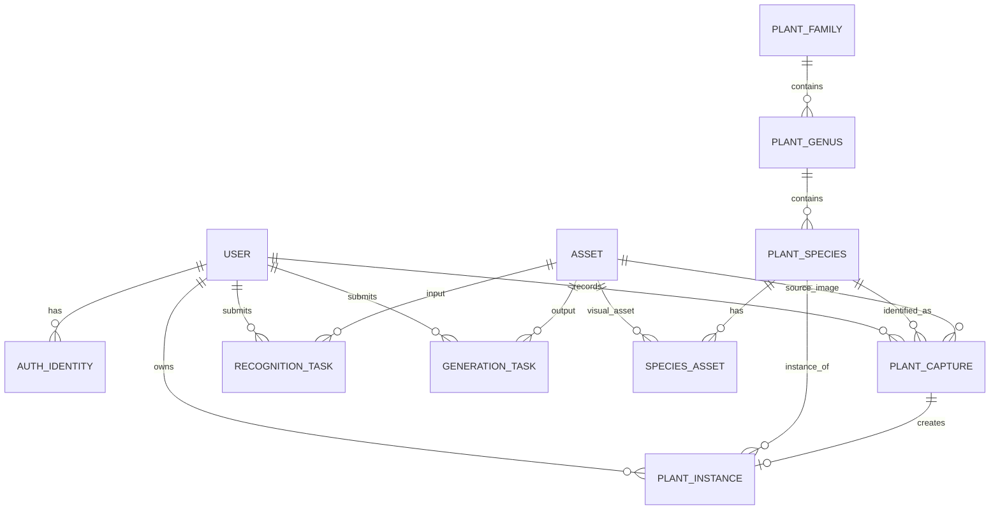

# 03 - 数据库设计

## 1. 建模原则

- `PlantSpecies`：自然界中的物种主数据。
- `PlantInstance`：用户在游戏中拥有的植物个体。
- `PlantCapture`：一次捕捉行为的审计记录。
- `Asset`：图片等文件的元数据。
- AI Task：识别或生成任务的持久化状态。
- 用户 ID 使用内部 ID，不以 openid 作为业务主键。
- 所有时间统一存 UTC；API 输出 ISO 8601，前端按用户时区展示。
- 重要写入使用事务和唯一约束保障幂等。

## 2. 核心实体

### User

| 字段 | 类型建议 | 说明 |
|---|---|---|
| id | UUID/CUID 字符串 | 内部用户 ID |
| status | enum | ACTIVE / DISABLED / PENDING_DELETION / DELETED |
| nickname | varchar | 用户昵称 |
| avatarAssetId | nullable FK | 头像资产 |
| deletionRequestedAt | nullable datetime | 注销申请时间 |
| createdAt | datetime | 创建时间 |
| updatedAt | datetime | 更新时间 |

### AuthIdentity

| 字段 | 类型建议 | 说明 |
|---|---|---|
| id | ID | 主键 |
| userId | FK | 内部用户 |
| provider | enum | WECHAT_MINI_PROGRAM |
| providerSubject | varchar | openid |
| unionId | nullable varchar | 满足条件时记录 |
| createdAt | datetime | 创建时间 |

唯一约束：`provider + providerSubject`。

openid 属于用户标识信息，应限制访问和日志输出。

### PlantFamily / PlantGenus / PlantSpecies

PlantFamily（科）：
- id
- scientificName（可空；现有数据只有中文科名，不自行补拉丁名）
- chineseName
- status

PlantGenus（属）：
- id
- familyId
- scientificName（沿用现有双名法中的属名）
- chineseName
- status

PlantSpecies（物种）：
- id
- genusId
- scientificName
- chineseName
- commonNames
- description
- baseCombatPower
- status
- createdAt
- updatedAt

三维属性名称尚未在产品文档或前端代码中出现，不设 `baseAttack`、`baseDefense`、`baseVitality` 列。战力换算公式未定，禁止猜测。环境加成在读取时计算，不写回 `baseCombatPower`。

物种外部数据源 ID 应通过未来的映射表维护，不要把某一个数据源的 ID 当作 FloraVerse 主键。当前不创建该表，方案见第 8 节。

### Asset

- id
- ownerUserId（系统资产可为空或使用 ownerType）
- storageProvider
- bucket
- objectKey
- publicUrl（可选；优先运行时生成访问 URL）
- mimeType
- sizeBytes
- width
- height
- checksum
- visibility（PRIVATE / PUBLIC）
- createdAt

不要将二进制图片写入 MySQL。私有原图默认不公开访问。

### PlantCapture

- id
- userId
- speciesId
- sourceAssetId
- idempotencyKey
- capturedAt
- createdAt

不保存精确经纬度。当前环境展示使用前端按月份预设的气候，不读取用户坐标。地理探索若要做，再单独建位置模型。

### PlantInstance

- id
- ownerUserId
- speciesId
- captureId
- level
- experience
- quality（COMMON / UNCOMMON / RARE / LEGENDARY，独立于战力）
- attributeSeed（追溯初始生成，不代替当前快照）
- attributes（JSON：`{ version, attributes }`；属性名确认前 `attributes` 为空对象）
- attributeVersion（与快照 version 一致，可查询）
- combatPower（可空；公式确定前保持空，且不得写入环境加成）
- createdAt
- updatedAt

成长数值和品质由服务端写入。客户端不能提交战力或属性作为可信输入。属性 JSON 的键必须来自已确认名称；目前产品代码只有 `baseCombatPower`，没有已确认的三维属性名。

### SpeciesAsset

- id
- speciesId
- assetId
- assetType（ICON / CARD / PORTRAIT / STAGE）
- growthStage（nullable）
- variant
- version
- status（DRAFT / APPROVED / PUBLISHED / REJECTED）
- createdAt

### RecognitionTask

- id
- userId
- assetId
- provider
- model
- status（PENDING / PROCESSING / SUCCEEDED / FAILED）
- candidatesJson
- errorCode
- errorMessage（脱敏）
- attempts
- createdAt
- startedAt
- finishedAt

### GenerationTask

- id
- userId
- speciesId（nullable，按生成场景）
- promptTemplateVersion
- provider
- model
- requestParamsJson
- status（PENDING / PROCESSING / SUCCEEDED / FAILED / CANCELLED）
- resultAssetId（nullable）
- providerRequestId（nullable）
- errorCode
- errorMessage（脱敏）
- attempts
- idempotencyKey
- createdAt
- startedAt
- finishedAt

唯一约束建议：`userId + idempotencyKey`。

### UserCollectionStats

- userId（唯一）
- distinctSpeciesCount
- totalInstanceCount
- totalPower
- updatedAt

该表属于可重建的派生统计。业务写入成功后更新，定期可由任务重算校验。

## 3. 关系图

## 4. 事务与幂等

确认捕捉时，在一个数据库事务内：
1. 锁定或校验 RecognitionTask。
2. 校验任务归属当前用户且状态为 SUCCEEDED。
3. 校验尚未被消费。
4. 校验 speciesId 属于有效物种。
5. 创建 PlantCapture。
6. 创建 PlantInstance。
7. 更新 UserCollectionStats。
8. 标记识别任务已消费。

重复请求必须返回原结果或明确的冲突响应，不能创建重复个体。

## 5. 索引建议

- AuthIdentity(provider, providerSubject) UNIQUE
- PlantSpecies(genusId, status)
- PlantSpecies(scientificName)
- PlantCapture(userId, capturedAt)
- PlantCapture(userId, speciesId)
- PlantInstance(ownerUserId, createdAt)
- PlantInstance(ownerUserId, speciesId)
- RecognitionTask(userId, createdAt)
- GenerationTask(userId, createdAt)
- GenerationTask(status, createdAt)
- GenerationTask(userId, idempotencyKey) UNIQUE

## 6. 排行榜规则

物种收录数按 `COUNT(DISTINCT speciesId)` 计算；植物总战力按有效 PlantInstance 的服务端计算结果汇总。

初期可直接 MySQL 查询或读取统计表。只有在真实数据量和查询压力证明有必要时，才引入 Redis ZSET。

## 7. 已确认的设计决策

以下决策覆盖前文草稿中冲突的字段。已应用迁移 `20261126030423_core_domain` 不被修改。后续结构调整使用新迁移。

1. 战力以 `PlantSpecies.baseCombatPower` 为永久基础值。环境加成只在读取时计算。三维属性与战力的换算公式未定，不设对应列，也不允许用猜测值填充。
2. 个体品质使用 `PlantInstance.quality`，取值为 `COMMON`、`UNCOMMON`、`RARE`、`LEGENDARY`。它不参与当前战力计算。物种表不另存稀有度。
3. 个体属性快照为 JSON：`{ "version": string, "attributes": {} }`。列 `attributeVersion` 与 `version` 保持一致；`attributeSeed` 只追溯初始生成过程。属性名确认前，`attributes` 只能是空对象。
4. 科的拉丁学名允许为空，不自行补全。属的拉丁学名继续使用物种双名法中的属名。
5. 不创建外部分类映射表。预留方案见第 8 节。
6. 不持久化精确经纬度。
7. 用户外键保持 `ON DELETE RESTRICT`。注销使用状态机，不用级联删除。流程见第 9 节。
8. 中文名保留普通索引 `(status, chineseName)`。不引入 Elasticsearch，不建别名表。扩展方向见第 10 节。

## 8. 未来的外部物种映射

需要对接外部物种库时，再新增 `PlantSpeciesExternalMapping`，不把外部 ID 写入 `PlantSpecies.id`。

建议字段：

- `id`
- `speciesId`：指向 `PlantSpecies`
- `source`：数据源名称
- `externalId`：该数据源中的标识

唯一约束建议为 `source + externalId`，以及 `speciesId + source`。当前不建表，也不预写迁移。

## 9. 账号注销

用户状态：

| 状态 | 含义 |
|---|---|
| ACTIVE | 正常 |
| DISABLED | 封禁，可恢复，不是注销 |
| PENDING_DELETION | 已申请注销，禁止登录和新的个人写入，数据仍保留 |
| DELETED | 匿名化完成，用户主键仍保留，供现有外键引用 |

`deletionRequestedAt` 记录申请时间。本次不设冷静期。若产品以后要求冷静期，使用这个时间戳，不改外键。

处理分三层，本次只定义职责，不实现接口：

1. 同步软标记：状态改为 `PENDING_DELETION`，清空昵称和头像引用。不删除用户行。
2. 匿名化：由后续显式任务删除该用户的 `AuthIdentity`，使 openid 不再保留。用户行改为 `DELETED`。植物个体改为 `InstanceStatus.DELETED`，收录审计行保留。
3. 异步清理对象存储：只删除 `ownerUserId` 属于该用户、且没有被物种主数据引用的 Asset 文件。物种封面和属主为空的共享资源不删除。文件删除成功后，才能解除收录上的图片引用并删除对应 Asset 行。外键是 `RESTRICT`，任务必须按这个顺序显式处理，不能依赖数据库级联。

## 10. 中文搜索的后续方向

当前用 `plant_species (status, chineseName)` 做等值或前缀过滤。`commonNames` 存在 JSON 中，不参与索引。

需要模糊搜索时，优先评估 MySQL 的 ngram 全文索引。确认中文分词和排序要求之前，不引入 Elasticsearch，也不把别名拆成独立表。

## 11. 任务 2.1 已落地范围

首个领域迁移：`prisma/migrations/20261126030423_core_domain`。

已建表：`users`、`auth_identities`、`plant_families`、`plant_genera`、`plant_species`、`assets`、`plant_captures`、`plant_instances`。

决策收敛后的结构调整另见新的 Prisma migration，不回改上述文件。
