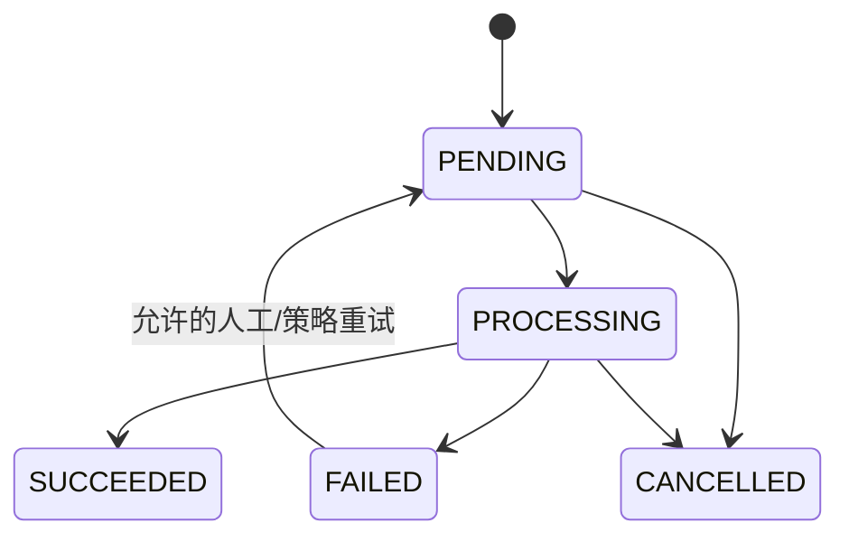
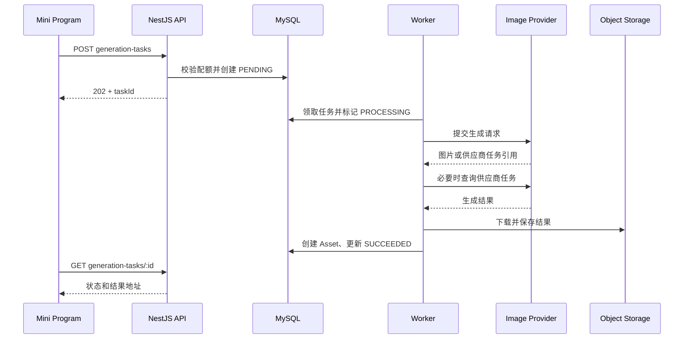

# 07 - AI 植物图像实时生成设计

## 1. 产品决策

FloraVerse V1 采用**实时触发生成**：
- 用户在小程序明确触发生成。
- 后端立即创建持久化任务。
- Worker 调用图像生成 API。
- 生成成功后将图片保存到对象存储。
- 小程序查询任务状态并展示结果。

这里的“实时”指用户触发后开始生成，不代表同步 HTTP 响应，也不承诺固定完成时间。

## 2. 生成场景

V1 建议先限定一个清晰场景，例如：
- 用户为某个已收录物种生成专属形象；或
- 用户对已有植物个体触发一次形象生成。

不要第一版同时开放任意 Prompt、无限尺寸、任意参考图和无限重生成。自由输入会增加成本、安全审核和视觉一致性难度。

建议客户端只传业务参数：
- scene
- speciesId 或 instanceId
- growthStage（如适用）
- styleId
- idempotency key

Prompt 由服务端模板生成，避免客户端任意控制供应商请求。

## 3. Provider 接口

```ts
export interface ImageGenerationProvider {
  generate(input: {
    prompt: string;
    negativePrompt?: string;
    referenceImageUrls?: string[];
    width: number;
    height: number;
    model?: string;
  }): Promise<{
    providerRequestId?: string;
    imageUrl?: string;
    outputBytes?: Uint8Array;
    metadata?: Record<string, unknown>;
  }>;
}
```

注意：不同供应商可能是同步返回图片、异步返回任务 ID，或先提交后轮询。Adapter 应封装差异，内部统一为“提交/查询/取回结果”生命周期。不要假设所有 API 都使用同一种协议。

## 4. 任务状态机



终态：SUCCEEDED、FAILED、CANCELLED。

任务必须有：
- taskId
- userId
- scene
- provider / model
- promptTemplateVersion
- requestParams（不含密钥）
- idempotencyKey
- status
- attempts
- createdAt / startedAt / finishedAt
- providerRequestId
- resultAssetId
- errorCode

## 5. 生成任务流程



## 6. 低成本任务执行方案

V1 不强制 Redis/BullMQ。使用 MySQL GenerationTask 表作为持久化队列。

Worker：
- 定期查询可领取任务。
- 使用事务和行锁领取任务。
- 设置 `lockedAt`、`lockedBy`、`leaseExpiresAt` 或等价租约字段。
- 任务超时后允许其他 Worker 回收。
- 使用有限重试和退避。
- 进程重启后可恢复未完成任务。

MySQL 版本和 Prisma 对行锁/原生 SQL 的支持需要在实现时验证。领取任务的并发逻辑应使用原子 SQL 或事务，不能采用“先 SELECT、再 UPDATE”的非原子方式。

## 7. 成本与滥用控制

必须有：
- 每用户每日生成额度。
- 每用户同时进行中的任务上限。
- 全局每日预算/熔断开关。
- Idempotency-Key。
- Prompt 模板白名单。
- 图片尺寸和输出格式白名单。
- 供应商调用超时。
- 有限重试。
- 记录模型、参数、耗时、供应商请求 ID 和成本（可获取时）。

供应商超时不一定代表没有生成或没有扣费。重试前要考虑供应商任务状态查询，避免重复收费。

## 8. 视觉资产策略

实时生成会带来风格波动。建议：
- 固定统一的画风模板。
- 固定画幅和主体构图。
- 对每个 species/instance 保存生成版本。
- 生成结果先进入 PENDING_REVIEW 或按产品风险策略审核。
- 通过后关联 SpeciesAsset 或 InstanceAsset。
- 不覆盖历史资产，保留版本和来源。
- 未来用参考图、角色设定图或专属模型提升一致性。

## 9. 用户体验

前端状态建议：
- PENDING：排队中。
- PROCESSING：正在生成。
- SUCCEEDED：生成完成。
- FAILED：生成失败，可按规则重试。

轮询建议采用递增间隔，例如 1.5s、2s、3s、5s，并设置最大轮询时长；页面切后台时降低轮询频率。只有后端实际能提供阶段进度时才显示百分比，否则展示状态文案即可。

## 10. 合规与内容安全

接入前核实供应商商用授权、内容审核、数据留存和训练使用条款。上线前评估生成合成内容标识要求、平台审核规则及服务提供方责任。保留必要的生成记录、模型信息和标识信息。具体义务以届时有效法规、主管部门要求和平台规则为准。
